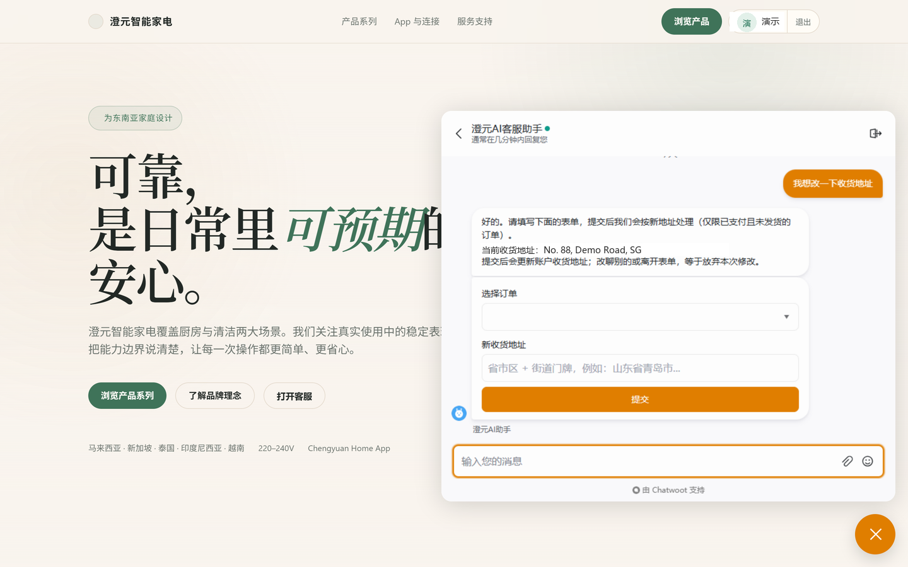
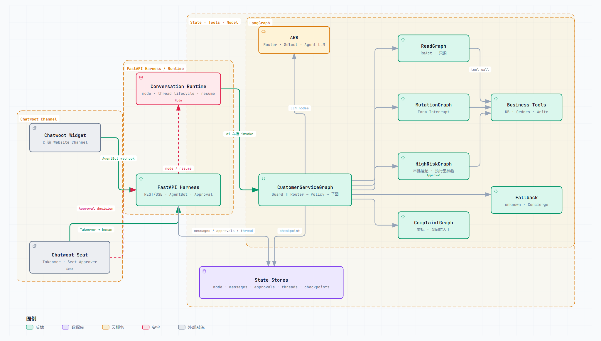

# AI Service Agent

[](https://github.com/wlyqiqi/ai-service-agent-root/actions/workflows/ci.yml)
[](LICENSE)
[](https://www.python.org/downloads/)
[](https://www.langchain.com/langgraph)

## 项目定位与状态

面向电商客服的 **Agent Harness（可运行参考实现）**。LLM 负责理解，确定性工作流负责权限、执行与恢复；关键写操作必须经过结构化表单或人工审批，高风险操作与人工接管保持独立的安全边界。

这里的 **Harness** 指包裹模型的运行时边界：FastAPI Transport、LangGraph 编排、Policy、Approval、Handoff、State、Thread Lifecycle 与可观测性。

> **状态：`v0.1.0` / Demo**
>
> 适合架构参考、本地演示与二次开发，不作为生产 SLA 或开箱即用的通用客服 SaaS 承诺。



_演示：用户在 Chatwoot Widget 中发起地址修改，系统通过 Form Interrupt 收集结构化字段，确认后才进入写路径。图片使用虚构演示数据。_

## 核心价值与差异化

- **Deterministic authority**：LLM 只负责理解，Guard、Policy Gate、Safety Precheck、属主校验和审批状态由确定性代码决定。
- **风险分层执行**：Read、Mutation、HighRisk、Complaint、Fallback 使用不同子图与工具边界，不做“万能 Agent”。
- **人工审批与接管是一等能力**：HighRisk 走独立审批旁路；转人工采用 Seat-gated Handoff，申请不会直接切 `human`，只有 **Seat Takeover** 才真正进入人工车道。
- **可恢复、可观测**：官方 `interrupt` / `Command(resume=...)`、SQLite checkpointer、Thread Lifecycle、SSE 事件和 Harness hooks 共同组成完整运行链路。

适用场景：

- 需要展示 HITL（Human-in-the-loop）Agent 架构的工程作品集。
- 需要评估 LangGraph 中表单中断、审批恢复、人工接管和风险分层设计的团队。
- 希望以确定性边界约束 LLM 工具调用的客服自动化原型。

不适用场景：

- 需要多租户、生产级 SLA、横向扩展或托管客服平台的项目。
- 只需要普通 RAG 问答、没有写操作或人工审批需求的聊天机器人。
- 希望让 LLM 自由决定权限、金额、审批或数据边界的系统。

## 演示

主演示链路：

1. 用户要求修改收货地址，Router 与 Policy 将请求路由到 Mutation。
2. Mutation Select 绑定写工具，随后发出 `form_required` Form Interrupt。
3. 用户提交表单，Transport 转为 `Command(resume=...)`，在同一 `thread_id` 上恢复。
4. 工具只执行一次，最终以 `tool_call`、`tool_result` 和 `done` 收尾。

另外三条关键链路：

- **HighRisk**：退款/取消订单先预检，再发出 `approval_required`；坐席通过审批旁路恢复，执行前重新校验，不切换 `conversation_mode`。
- **Handoff**：用户显式转人工或投诉确认后发出 `handoff_requested`；坐席 Takeover 后才发 `handoff_created` 并切到 `human`；Resolve 后发 `handoff_resolved` 回到 AI。
- **Complaint / Fallback**：投诉先安抚并询问是否转人工；无法归类或低置信度进入 Fallback。

## 架构



[打开交互式架构图](docs/diagrams/架构图/archify-architecture.html)

核心分层：

- **Transport**：FastAPI 只处理 REST、SSE、Webhook、审批 HTTP 和 Chatwoot 适配。
- **Conversation Runtime**：入口层判断 `conversation_mode=ai|human`，管理 pending interrupt、thread 生命周期与 resume。
- **LangGraph**：Guard ∥ Router → Policy → Read / Mutation / HighRisk / Complaint / Fallback 子图。
- **State & Tools**：业务工具、订单读写、SQLite checkpointer、消息、审批、Handoff 与 Thread Store 分职责存放。
- **Harness hooks**：事件、观测、审计和工具执行前后横切逻辑，不写进 Agent / 工具循环内部。

## Quick Start

### 1. 安装依赖

需要 Python 3.14 与 [uv](https://docs.astral.sh/uv/)。

```powershell
uv sync --group dev
```

### 2. 准备离线模拟数据

```powershell
uv run python scripts/seed_mock_db.py
```

### 3. 使用 fake model 启动

Windows PowerShell：

```powershell
$env:FAKE_MODEL = "true"
$env:AUTH_ENABLED = "false"
uv run ai-service-agent
```

macOS / Linux：

```bash
FAKE_MODEL=true AUTH_ENABLED=false uv run ai-service-agent
```

服务默认监听 `http://127.0.0.1:8000`。验证启动：

```powershell
Invoke-RestMethod http://127.0.0.1:8000/config
```

### 4. 完整本地演示

完整演示需要 Chatwoot、真实模型凭证和可选 LangSmith tracing：

```powershell
.\scripts\start_demo.ps1
.\scripts\stop_demo.ps1
```

前置配置、Webhook 与故障排查见 [`docs/ops/chatwoot-widget-agentbot-setup.md`](docs/ops/chatwoot-widget-agentbot-setup.md) 和 [`.env.example`](.env.example)。

## 核心流程

| 流程 | 典型输入 | 控制点 | 主要事件 / 恢复方式 |
|---|---|---|---|
| Read | “查一下我的订单” | Guard / Router / Policy → ReadGraph | `tool_call` → `tool_result` → `done` |
| Mutation | “把收货地址改成…” | Mutation Select → Form Interrupt → Resume | `form_required` / `form_rejected` → 确认后写库 → `done` |
| HighRisk | “订单 10086 申请退款” | Safety Precheck → Seat Approval → 执行前重校验 | `approval_required` → 审批旁路 `resume` → 工具只执行一次 |
| Handoff | “转人工”或投诉确认 | Seat-gated Handoff | `handoff_requested` → Seat Takeover → `handoff_created` → `human` → `handoff_resolved` |
| Complaint / Fallback | 投诉、低置信度、unknown | ComplaintGraph / FallbackGraph | 先安抚或给出兜底，不自动越过人工边界 |

关键不变量：

- Form Interrupt 挂起期间纯文本不得写库；恢复必须使用官方 `Command(resume=...)`。
- HighRisk 的人工审批与人工接管是不同语义：审批不自动切 `human`，Seat Takeover 才切人工车道。
- `conversation_mode` 两态；`thread_id` 是独立 checkpoint 标识。
- 每个 turn 以 `done` 结束；错误也要先发 `error` 再发 `done`。

## API 与 SSE

最小 REST 流程：

```powershell
# 创建会话
$session = Invoke-RestMethod -Method Post `
  -Uri http://127.0.0.1:8000/sessions `
  -ContentType application/json `
  -Body '{"user_id":"demo-user"}'

$session.session_id
```

发起对话并消费 SSE：

```bash
curl -N -X POST http://127.0.0.1:8000/chat \
  -H "Content-Type: application/json" \
  -d '{"session_id":"<session_id>","message":"查订单状态"}'
```

事件统一为 `{ "type": string, "data": object }`：

```text
data: {"type":"token","data":{"text":"..."}}
data: {"type":"tool_call","data":{"name":"order_lookup","args":{"order_id":"..."}}}
data: {"type":"tool_result","data":{"name":"order_lookup","ok":true,"summary":"..."}}
data: {"type":"done","data":{"final":"...","message_id":"..."}}
```

完整协议、表单与审批事件见 [`docs/specs/event-spec.md`](docs/specs/event-spec.md)。

## 测试与评估

```powershell
# 单元 / 集成测试
uv run pytest

# 离线确定性评估：routing / policy / guard / handoff
uv run python -m ai_service_agent.evals --data tests/evals/control --out eval-report.json

# LangGraph 图结构校验
uv run langgraph validate
```

CI 状态由首屏 badge 实时反映；README 不硬编码易过期的测试通过数。评估数据集位于 [`tests/evals/control/`](tests/evals/control/)，真实模型 SSE 证据见 [`docs/real-model-smoke.md`](docs/real-model-smoke.md)。

## Known Limitations

| 限制 | 当前行为 | 证据 / 后续 |
|---|---|---|
| Guard v1 仅覆盖字面规则 | 字面 adversarial 样本可拦截，同义替换或间接暗示存在漏判 | [`2026-09-15-p4-guard-llm-eval.md`](docs/decisions/2026-09-15-p4-guard-llm-eval.md) |
| 写操作必填参数来源未校验 | 模型可能编造订单号等必填参数；已登记为残余风险 | [`2026-09-16-ctrl-0076-clarify-verification.md`](docs/decisions/2026-09-16-ctrl-0076-clarify-verification.md) |
| Thread 生命周期为 Demo 范围 | 单进程 SQLite、30 个完成 turn 或 24 小时空闲后轮换，无多 worker 租约 | [`thread-lifecycle-spec.md`](docs/specs/thread-lifecycle-spec.md) |
| 完整演示依赖外部环境 | 真实模型、Chatwoot、LangSmith 与 ARK 端点需要单独配置；默认 Quick Start 只使用 fake model | [`project-audit.md`](docs/project-audit.md) |

## 文档导航

- 规格索引：[`docs/specs/README.md`](docs/specs/README.md)
- 领域术语：[`CONTEXT.md`](CONTEXT.md)
- 架构决策：[`docs/adr/`](docs/adr/)
- 图表索引：[`docs/diagrams/README.md`](docs/diagrams/README.md)
- 环境与能力审计：[`docs/project-audit.md`](docs/project-audit.md)
- 真实模型冒烟：[`docs/real-model-smoke.md`](docs/real-model-smoke.md)
- 本地 Chatwoot 接线：[`docs/ops/chatwoot-widget-agentbot-setup.md`](docs/ops/chatwoot-widget-agentbot-setup.md)
- 评估数据：[`tests/evals/control/`](tests/evals/control/)

## License

[MIT](LICENSE) © 2026 Wang Qi
