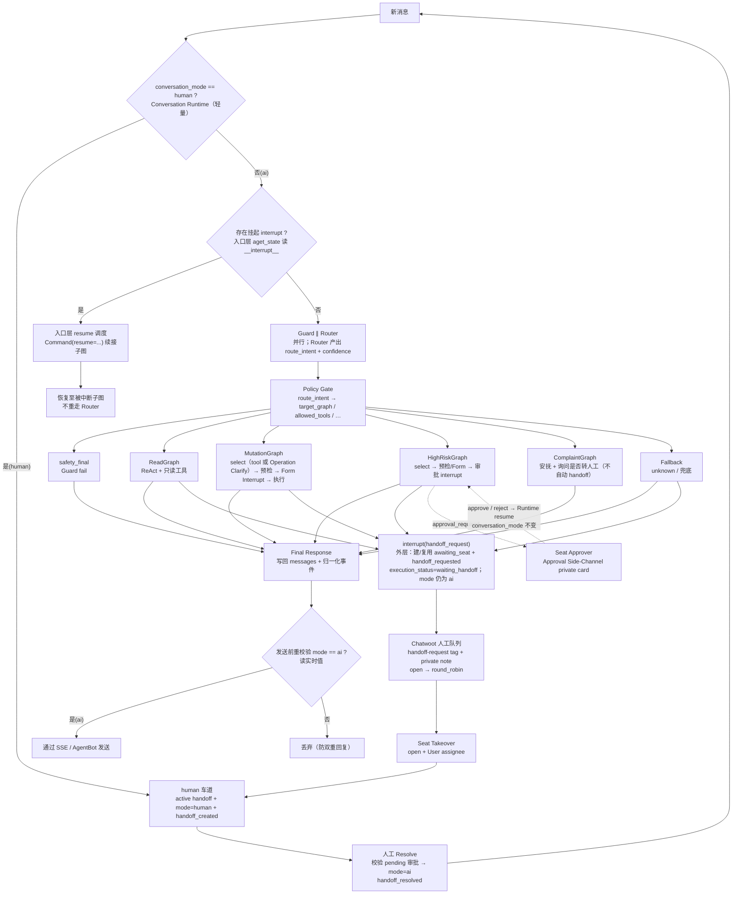

# CustomerServiceGraph 总图（AI 路径内部结构）

> 权威定义：`docs/specs/graph-spec.md`、`docs/specs/handoff-spec.md`。
> 顶层会话流程见 `handoff-overview.svg`。Archify 渲染版见 `架构图/archify-architecture.html`。

## 关键注记

- Guard 为确定性规则包（与 Router 并行）；fail 走 `safety_final`，不消费 Router 分类结果做子图路由。
- Router 唯一语义输出是 `route_intent` + `confidence`；子图选择由 Policy Gate 确定性派生（见 `state-spec.md`）。
- Mutation 主路径用 Form Interrupt（`form_required`），不是聊天 `confirmation_required`；tool 未定由 Mutation `mutation_select_llm` 内联 Operation Clarify（ADR 0004），无入口 Hybrid。HighRisk 工具选择为 `high_risk_select_llm`（ADR 0005）。
- Handoff Request 只挂起并创建/复用 `awaiting_seat` 记录，`mode` 保持 `ai`；Chatwoot 队列 round-robin 后，`open + User assignee` 触发 Seat Takeover，才进入 human 并发出 `handoff_created`。
- Approval Side-Channel 与 Seat Takeover 相互独立：审批卡/decision 只恢复 HighRiskGraph，不切换 `conversation_mode`（ADR-0002 / ADR-0006）。
- ComplaintGraph 不挂 Fallback，也不走 Concierge `explain_llm`；Complaint 只安抚并询问是否转人工。
- Form / 审批挂起时父图 `execution_status` 常仍为 `routing`；对外权威是 checkpointer `__interrupt__`。
- `conversation_id=session_id`；`thread_id` 是 LangGraph checkpoint 标识，不是同一字段。thread 惰性创建、可在安全边界轮换；pending interrupt 与活跃 handoff/审批会固定 thread，ThreadReaper 由离线 CLI 与 FastAPI lifespan 共用（见 `thread-lifecycle-spec.md`）。
